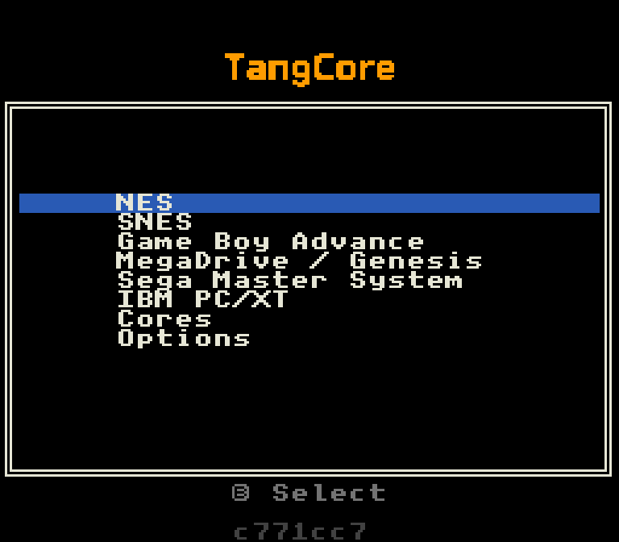

# TangCore Retro Gaming Installation Guide

## 🎮 Supported Devices

| Board Model       | FPGA Capacity | Compatible Cores             | Status        |
|-------------------|---------------|------------------------------|---------------|
| Tang Console 60K  | 60K LUT       | All cores                    | ✔️ Great     |
| Tang Console 138K | 138K LUT      | All cores                    | ✔️ Great     |
| Tang Primer 25K   | 25K LUT       | NESTang, SNESTang            | ✔️ Experimental (v0.7) |
| Tang Nano 20K     | 20K LUT       | NESTang, SNESTang            | ✔️ Experimental (inindev fork), see [below](#tang-nano-20k) |

---

## 📦 Pre-Install Checklist
- [ ] Bouffalo Flash Cube v1.1 (in `tools/bflb_tools/bouffalo_flash_cube` of [Bouffalo SDK](https://github.com/bouffalolab/bouffalo_sdk), also a [local standalone version here](https://nand2mario.github.io/tangcore/user-guide/assets/bouffalo_flash_cube-1.1.zip))
- [ ] MicroSD card or USB 2.0 drive (FAT32/exFAT, ≤32GB recommended)
- [ ] USB-C OTG adapter with **power pass-through**
- [ ] Valid GBA BIOS (`gba_bios.bin`)
- [ ] Valid PC/XT BIOS (`bios.bin`)
- [ ] Latest [TangCore Release Package](https://github.com/nand2mario/tangcore/releases)

---

## 🔧 Firmware Installation

1. Extract release package
2. Launch Flash Cube → **Browse** → Select:
   ```bash
   /firmware-bl616/flash_<board-model>.ini
   ```
   *(e.g., `flash_console60k.ini`)*

3. Boot Mode Activation:
   - Hold **BOOT** button → Connect USB → Release after connection

   

   - Note for Tang Primer 25K: the primer does not have a BOOT button. [Short these two pins](https://nand2mario.github.io/tangcore/user-guide/primer25k.jpg) and connect USB instead.

4. Flash Process:
   - Refresh COM ports → Select Port/SN → **Download**
   - Confirm success screen:

     
   *Green status indicates successful programming*

5. Menu core: write it as in [writing the menu core](#writing-the-menu-core) below.

### Writing the menu core

The FPGA shows the main menu from an image in its own flash, the monitor core, so write it
there once with [openFPGALoader](https://github.com/trabucayre/openFPGALoader), and again
whenever the monitor core changes. openFPGALoader goes through Sipeed's USB debugger on the
BL616, which TangCore hands the USB port to in **Device Mode**:

1. Remove the SD card and the USB drive (on the Nano 20K, there is only the USB drive).
2. Connect the board's USB-C port straight to the computer: no OTG adapter, no hub.
3. Power up. Within about 10 seconds the computer sees `SIPEED USB Debugger`. If TangCore
   starts first, it finds no storage and nothing on its USB port, shows "Device Mode" (when a
   menu core is already in flash; on a first install the screen stays blank) and restarts as
   the debugger.
4. Write the monitor core for your board:

   | Board | Command |
   |---|---|
   | Tang Console 60K | `openFPGALoader -b tangconsole -f cores/console60k/monitor.bin` |
   | Tang Console 138K | `openFPGALoader -b tangconsole -f cores/console138k/monitor.bin` |
   | Tang Nano 20K | `openFPGALoader -b tangnano20k -f cores/nano20k/monitor.bin` |
   | Tang Primer 25K | `openFPGALoader -b tangprimer25k -f cores/primer25k/monitor.bin` |
   | Tang Mega 60K | `openFPGALoader -c ft2232 -f cores/mega60k/monitor.bin` |
   | Tang Mega 138K Pro | `openFPGALoader -b tangmega138k -f cores/mega138k/monitor.bin` |

5. Unplug, put the SD card or USB drive back, and power up: the menu appears.

Device Mode has been tested on the Nano 20K and the Console 138K; the Console 60K runs the
same code. On the Primer 25K and the Mega boards it is untested. If the computer never sees
the debugger, use [writing the menu core without Device Mode](monitor-core-recovery.md).

---

## 🕹️ Game System Setup

### SD/USB drive content
```bash
📁 /                
├── 📁 cores/        # `cores` directory from release
│    ├── 📁 console60k/
│    └── 📁 console138k/
├── 📁 nes/          # .nes rom files
├── 📁 snes/         # .smc/.sfc files
├── 📁 gba/
│    └── 🗎 gba_bios.bin  # GBA BIOS
├── 📁 genesis/      # .bin/.md files
├── 📁 sms/          # .sms files
└── 📁 pc/           # .img floppy images
│    └── 🗎 bios.bin  # PC 5160 BIOS
```

File names can use accented Latin letters (é, ñ, ö, ß, ...); characters from other scripts show
as `?` in the menu.

### Hardware Assembly
1. Connect components as shown (DS2 controller setup shown):
   

   *Left: OTG+USB | Right: DS2 PMOD+Wireless Receiver | Top: HDMI output*

2. Power sequence:
   - Insert USB drive → Connect OTG → Apply power

3. Initial Boot:
   - FPGA auto-programs (5-7 sec)
   - Main menu appears 

   

   *Navigation using gamepad*

---

## Tang Nano 20K

The steps above are for the Tang Console. On the Nano 20K, TangCore runs on the on-board
BL616 next to Sipeed's FPGA Partner firmware, in the slot FPGA-Companion would use. There is no
release package yet; build the cores and firmware as in [building from sources](../dev-guide/building.md#tang-nano-20k-linux).

### Firmware

1. The BL616 needs Sipeed's FPGA Partner firmware (`bl616_fpga_partner_20kNano.bin`) at flash
   address 0x0. Boards that run [FPGA-Companion](https://github.com/MiSTle-Dev/FPGA-Companion) on
   the BL616 already have it; it's in FPGA-Companion's `src/bl616/bl616_fpga_partner/`.
2. Put the BL616 in update mode: unplug the board, hold **UPDATE** (next to the HDMI connector),
   plug it into the computer, release. It shows up as `Bouffalo CDC DEMO`.
3. Write `fpga_firmware-bl616/build/build_out/tangcore_bl616.bin` to address 0x40000 with
   Bouffalo's flash tool (`BLFlashCommand`, or the open-source `bflb-mcu-tool`).
4. Write the monitor core (the main menu) to the FPGA's own flash in Device Mode, as in
   [writing the menu core](#writing-the-menu-core), with
   `fpga_monitorcore/impl/pnr/monitor_nano20k.bin`.

### USB drive

```bash
📁 /
├── 📁 cores/
│    └── 📁 nano20k/
│         ├── 🗎 monitor.bin    # optional: menu core, only loaded from Cores
│         ├── 🗎 nestang.bin    # from nestang_nano20k.bin
│         └── 🗎 snestang.bin   # from snestang_nano20k.bin
├── 📁 nes/          # .nes rom files
└── 📁 snes/         # .smc/.sfc files
```

- The board's TF slot is wired to the FPGA, not the BL616, so it can't hold the cores or ROMs.
  A USB microSD reader works.
- On macOS, eject the drive before unplugging it. Otherwise Finder leaves `._` files that show up
  in the menu as games; `dot_clean -m /Volumes/<drive>` removes them.

### Hardware

- Connect the USB drive, gamepads and keyboard to the USB-C port through a hub (up to 7 ports)
  and an OTG adapter with power pass-through.
- A USB keyboard works in the menu: arrow keys move, Enter or D is A, Space or S is B.
- Status messages appear on the bottom row of the menu.

---

[Report Issue](https://github.com/nand2mario/tangcore/issues)

